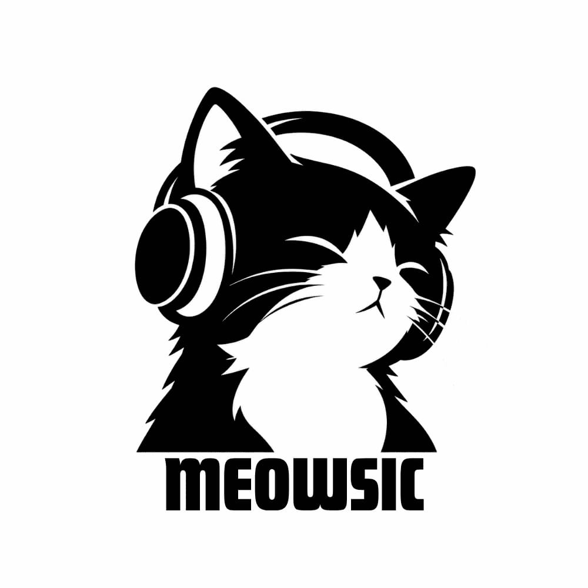

<div align="center">



### YouTube Music client for Android

<br/>

[](https://github.com/kanzzwoi/meowsic-metro/releases)
[](https://github.com/kanzzwoi/meowsic-metro/blob/main/LICENSE)
[](https://github.com/kanzzwoi/meowsic-metro/releases)

<br/>

[**Download**](#download) · [**Features**](#features)

</div>

---

<div align="center">

<h1><a id="download"></a>Download</h1>

<a href="https://github.com/kanzzwoi/meowsic-metro/releases">
  
</a>
<a href="https://meowsic.web.id">
  
</a>

</div>

---

<div align="center">

<h1><a id="features"></a>Features</h1>

<table>
  <tr>
    <td width="50%" valign="top">

#### Playback
- Stream songs, albums, and playlists from YouTube Music
- Background playback
- Download songs for offline listening
- Sleep timer

</td>
    <td width="50%" valign="top">

#### Lyrics & Discovery
- Synced lyrics with translation
- Search songs, albums, artists, and playlists

</td>
  </tr>
  <tr>
    <td width="50%" valign="top">

#### Library
- Local playlists and playlist import
- Backup and restore
- Listening stats and levels

</td>
    <td width="50%" valign="top">

#### Social & Interface
- Listen together with friends in real time
- Light, dark, black, and dynamic themes

</td>
  </tr>
</table>

</div>

---

## Build

```bash
git clone https://github.com/kanzzwoi/meowsic-metro.git
cd meowsic-metro
./gradlew :app:assembleFossDebug
```

---

## License

Meowsic is licensed under the [GPL-3.0](LICENSE).

---

## Disclaimer

This project is not affiliated with, endorsed by, or connected to YouTube or Google in any way.
